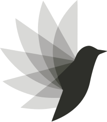

<picture>
  <source media="(prefers-color-scheme: dark)" srcset="packages/ui/src/brand/w-icon-on-dark.svg">
  
</picture>

# Wrenly

**An AI app builder you can self-host.**

Build with your team, the models you choose and infrastructure you control.
Describe an app, refine it through conversation, inspect its source and run it in an
isolated preview before publishing.

[Get started](https://usewrenly.org/docs/guides/installation) ·
[How it works](https://usewrenly.org/docs/architecture/overview) ·
[Roadmap](https://usewrenly.org/docs/roadmap) ·
[Contribute](CONTRIBUTING.md)

> Public beta. Check the [release notes](https://github.com/usewrenly/wrenly/releases)
> and known limitations before relying on it.

## Built around your choices

- **More than one stack.** Next.js and Laravel workflows, from generation to preview
  and private publishing. Vue and Django are planned.
- **Your models.** Local Ollama or supported OpenAI-compatible hosted connections,
  configured in the dashboard.
- **A place for your team.** Authenticated accounts, private invitations, project
  sharing and Viewer/Editor roles. Projects start private.
- **Source you can keep.** Saved revisions, follow-up edits and source ZIP downloads.
- **Infrastructure you control.** Docker-isolated execution; private publishing starts
  with Gitea, a private image registry and Coolify. Other integrations are planned.

Development app databases are **Experimental** and opt-in. Production app databases
and database-backed publishing are unavailable. Skills provide reusable instructions;
Figma and other external MCP connectors are roadmap work.

## Run Wrenly

The current installation uses a source checkout on a Linux Docker host. You need
**Bun 1.3.14, Node.js 24+, Git and Docker**. Only the person running the instance installs
it; invited users open its browser address and sign in.

Follow **[Install Wrenly](https://usewrenly.org/docs/guides/installation)** for configuration,
migrations and protected first-owner setup. Then connect a model in Settings.
[Previews](https://usewrenly.org/docs/guides/local-previews) and
[publishing](https://usewrenly.org/docs/guides/publishing-setup) have separate setup steps.
A packaged installer is not released yet.

Self-hosting requires no external Wrenly account. Prompts and context go to the model
provider you select; choose a local model for local inference.

## Make it better

Start with the [contributor guide](CONTRIBUTING.md) and
[repository map](https://usewrenly.org/docs/architecture/project-structure).
Report reproducible bugs through Issues and suspected vulnerabilities through the
[private reporting process](SECURITY.md). AI-assisted contributions follow [AGENTS.md](AGENTS.md).

[Apache-2.0](LICENSE). Third-party assets retain the notices beside their source.
Built by James Kamwendo and the Wrenly community.
