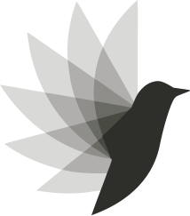
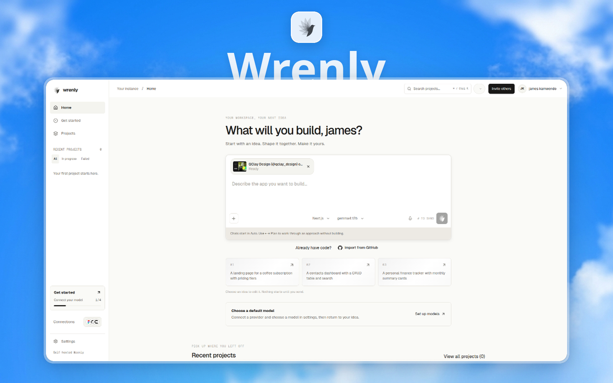

<picture>
  <source media="(prefers-color-scheme: dark)" srcset="packages/ui/src/brand/w-icon-on-dark.svg">
  
</picture>

# Wrenly

[](https://github.com/usewrenly/wrenly/actions/workflows/ci.yml)
[](LICENSE)
[](https://github.com/usewrenly/wrenly/releases)

**An AI app builder you can self-host.**

Build with your team, the models you choose and infrastructure you control.
Describe an app, refine it through conversation, inspect its source and run it in an
isolated preview before publishing.

[Get started](https://usewrenly.org/docs/guides/installation) ·
[How it works](https://usewrenly.org/docs/architecture/overview) ·
[Roadmap](https://usewrenly.org/docs/roadmap) ·
[Contribute](CONTRIBUTING.md)

> Public beta. Check the [release notes](https://github.com/usewrenly/wrenly/releases)
> and known limitations before relying on it.



## Built around your choices

- **More than one stack.** Next.js and Laravel workflows, from generation to preview
  and private publishing. Vue and Django are planned.
- **Your models.** Local Ollama or supported OpenAI-compatible hosted connections,
  configured in the dashboard.
- **A place for your team.** Authenticated accounts, private invitations, project
  sharing and Viewer/Editor roles. Projects start private.
- **References alongside your prompt.** Attach screenshots or short text documents;
  image input requires a compatible, configured model.
- **Voice dictation & framework inspection.** Opt-in local Whisper speech-to-text and
  isolated Laravel Boost / Next.js DevTools MCP inspection.
- **Source you can keep.** Saved revisions, follow-up edits, source ZIP downloads, plus
  GitHub repository import and reviewed branch export.
- **Infrastructure you control.** Docker-isolated execution; private publishing starts
  with Gitea, a private image registry and Coolify. Other integrations are planned.

Development app databases are **Experimental** and opt-in. Production app databases
and database-backed publishing are unavailable. Skills provide reusable instructions;
Figma and other external MCP connectors are roadmap work.

## Run Wrenly

Start a local or self-hosted instance with the guided installer on **Linux x86_64**
(**Bun 1.3.14+, Node.js 24+, Docker Engine with Compose v2, `util-linux` (`flock`),
and at least 10 GiB free disk space**):

```bash
bunx @wrenly/cli
# or with npm / pnpm / yarn:
npx @wrenly/cli
pnpm dlx @wrenly/cli
yarn dlx @wrenly/cli
```

Only the person running the instance installs it; invited teammates open its browser
address and sign in. Running without arguments starts the interactive wizard; opt-in
flags enable isolated previews (`--previews`), Laravel 13 (`--laravel`), official MCP
framework inspection (`--inspection`), local Whisper dictation (`--dictation`), and
experimental Development app databases (`--databases`).

See **[Guided CLI Installer](https://usewrenly.org/docs/guides/guided-installer)** for
lifecycle commands, or follow **[Manual Source Install](https://usewrenly.org/docs/guides/installation)**
to run directly from a Git checkout. [Previews](https://usewrenly.org/docs/guides/local-previews)
and [publishing](https://usewrenly.org/docs/guides/publishing-setup) also have
dedicated guides.

Self-hosting requires no external Wrenly account. Prompts and context go to the model
provider you select; choose a local model for local inference.

## Make it better

Start with the [contributor guide](CONTRIBUTING.md) and
[repository map](https://usewrenly.org/docs/architecture/project-structure).
Report reproducible bugs through Issues and suspected vulnerabilities through the
[private reporting process](SECURITY.md). AI-assisted contributions follow [AGENTS.md](AGENTS.md).

[Apache-2.0](LICENSE). Third-party assets retain the notices beside their source.
Built by James Kamwendo and the Wrenly community.
