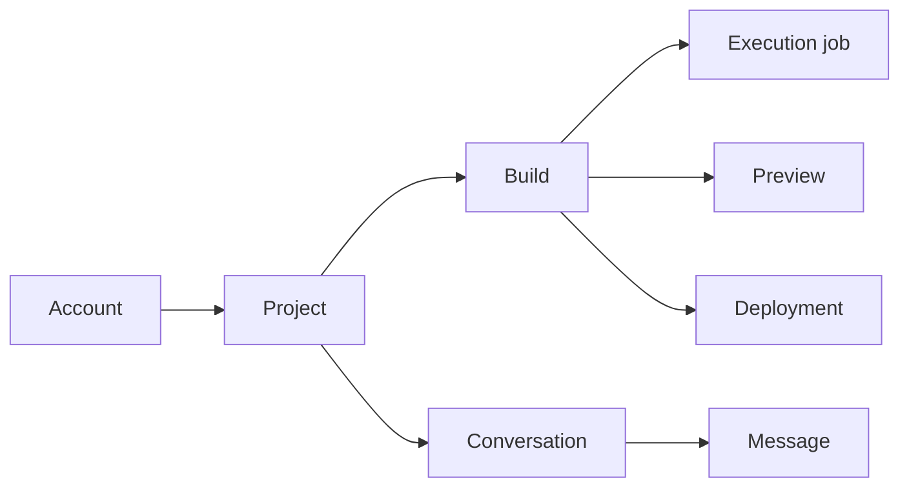

# The records Wrenly saves

A booking-app project has a name and owner. Each request to build it adds a build;
conversation messages explain what the user asked and what happened. These files
describe those records in Wrenly's control database, not the booking app's tables.

Drizzle uses these definitions both to construct queries and infer stored row types.
For example, `typeof projects.$inferSelect` describes a saved project row. Import that
existing definition instead of maintaining a second interface with the same columns.
Public HTTP responses still need explicit safe projections: a stored record can include
private fields that should never reach the browser.

## Where a record belongs

| Folder | What it groups |
| --- | --- |
| `identity/` | Better Auth accounts/sessions, organizations, owner setup, member access and pictures. |
| `projects/` | Projects, explicit sharing, selected model and drafts. |
| `execution/` | Builds, durable jobs and conversation history/actions. |
| `resources/` | Preview, deployment and separate app-database metadata. |
| `configuration/` | Provider catalog/connections and versioned Skills. |

## Constraints and authorization do different work

A **foreign key** checks that a referenced row exists. A **unique constraint** prevents
duplicate stored identities. Neither decides that the current user may read a private
project or perform a particular state transition. API transaction helpers check current
sessions, membership, project roles, revisions and work blockers as well.

For example, an Editor can contribute with a project's selected model while a Viewer
can read saved source. The project creator controls sharing and publishing. Instance
administration alone does not grant access to somebody else's private project.
Changing a sharing or media policy advances its access revision and invalidates old
preview grants; signing out invalidates the session those grants depend on.

Jobs and actions save their admitted settings so later provider/skill changes cannot
rewrite work already accepted. Workers must still prove their current claim and lease
before updating execution. Tables and enums describe stored possibilities, not proof
that a framework or deferred product feature is ready for users.

## Changing definitions

The central `index.ts` exports every table for tooling and consumers. Update definitions
through reviewed Drizzle migrations; changing a TypeScript table alone does not alter
an installed database. Existing SQL migrations and metadata remain historical install
inputs and must not be rewritten merely to tidy comments or folders.
